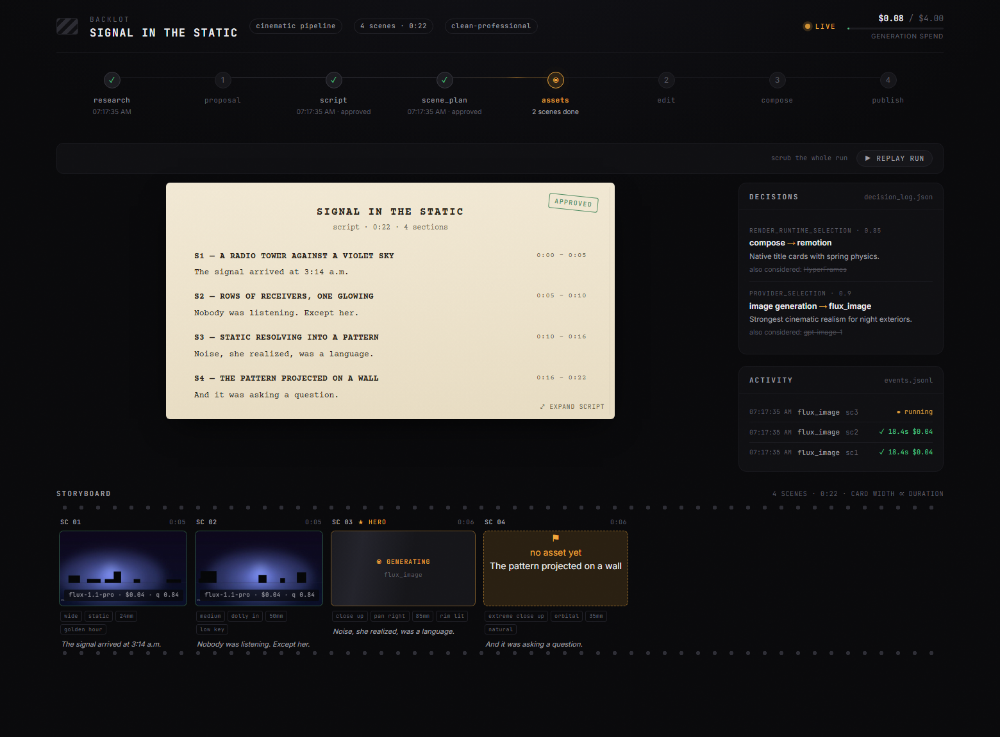
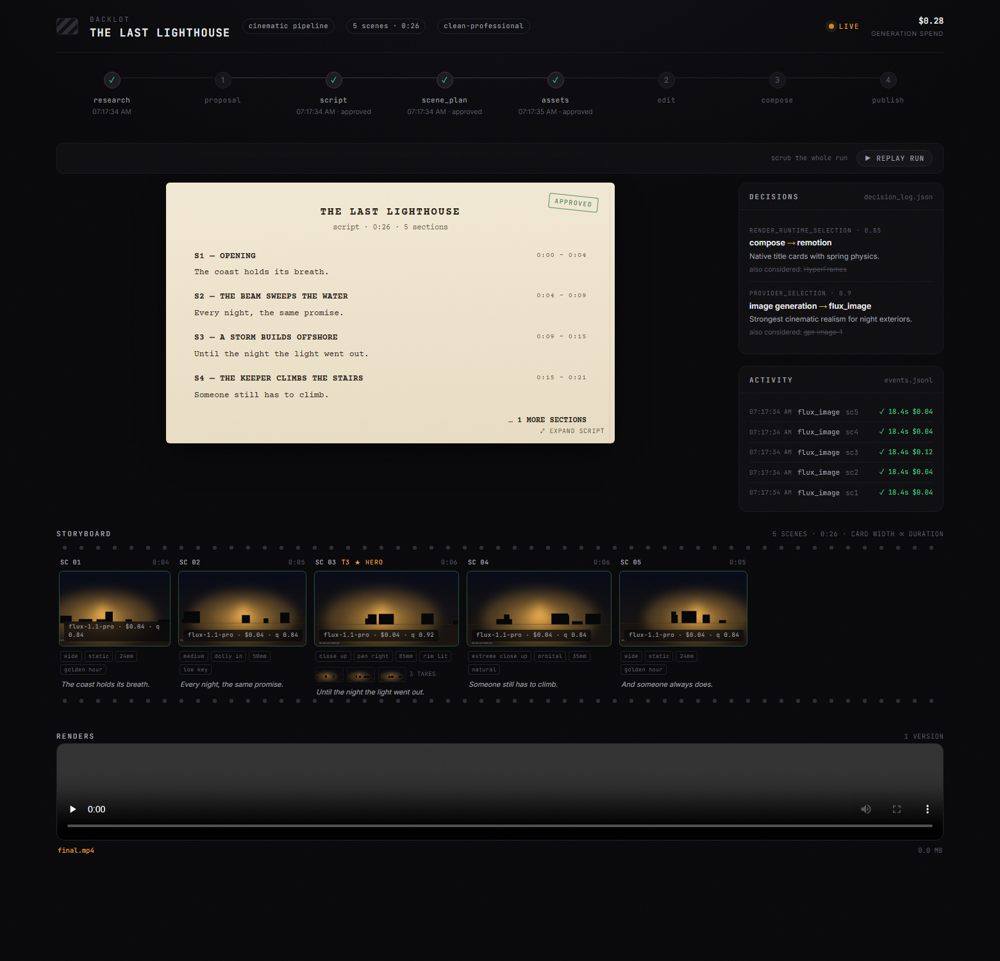
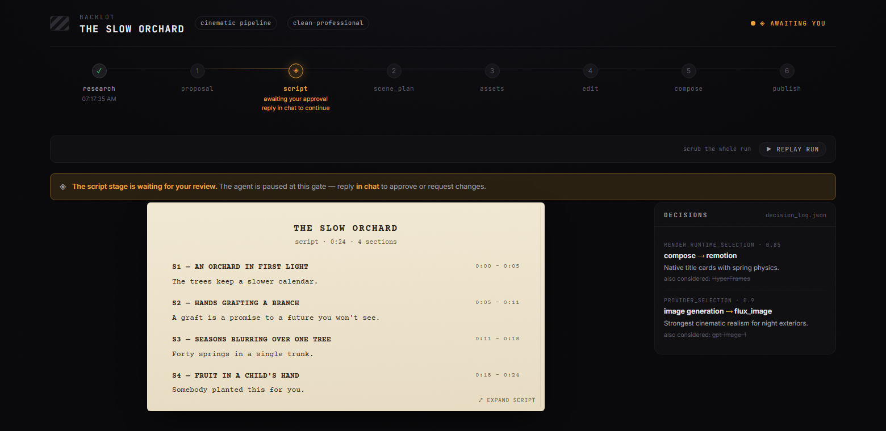
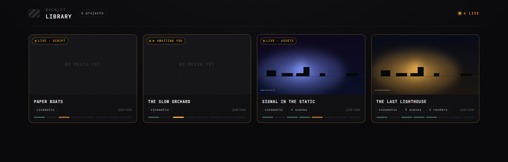

[English](README.md) | **Tiếng Việt** | [Português (Brasil)](README_pt-BR.md) | [Español](README_es.md) | [简体中文](README_zh-CN.md)

<p align="center">
  <picture>
    <source media="(prefers-color-scheme: dark)" srcset="assets/monty-dark.svg">
    
  </picture>
</p>

<p align="center"><sub><em>Monty the Clapper — linh vật chính thức của OpenMontage</em></sub></p>

<h1 align="center">OpenMontage</h1>

<p align="center"><strong>Hệ thống sản xuất video agentic mã nguồn mở đầu tiên trên thế giới.</strong></p>

<p align="center">
  <a href="https://openmontage.video"></a>
</p>

<p align="center">
  <a href="#bắt-đầu-từ-một-video-bạn-yêu-thích">Dán Link Video Mẫu</a> &nbsp;·&nbsp;
  <a href="#cài-đặt-nhanh-quick-start">Cài đặt Nhanh</a> &nbsp;·&nbsp;
  <a href="#thử-ngay-các-prompt-mẫu">Prompt Mẫu</a> &nbsp;·&nbsp;
  <a href="#các-pipeline-sản-xuất">Pipelines</a> &nbsp;·&nbsp;
  <a href="#cơ-chế-hoạt-động">Cơ chế Hoạt động</a> &nbsp;·&nbsp;
  <a href="docs/PROVIDERS.md">Providers</a> &nbsp;·&nbsp;
  <a href="docs/PR_REVIEW_GUIDE.md">Review Guide</a> &nbsp;·&nbsp;
  <a href="AGENT_GUIDE.md">Agent Guide</a>
</p>

<p align="center">
  <a href="LICENSE"></a>
</p>

<p align="center">
  <a href="https://github.com/trending">
    <picture>
      <source media="(prefers-color-scheme: dark)" srcset=".github/assets/repo-of-the-day-dark.svg">
      
    </picture>
  </a>
</p>

<p align="center"><strong>Theo dõi quá trình phát triển</strong></p>

<p align="center">
  <a href="https://www.youtube.com/@OpenMontage"></a>
  <a href="https://www.instagram.com/openmontageinc/"></a>
  <a href="https://x.com/calesthioailabs"></a>
  <a href="https://github.com/calesthio/OpenMontage/discussions"></a>
</p>

---

Biến trợ lý lập trình AI của bạn thành một studio sản xuất video hoàn chỉnh. Chỉ cần mô tả ý tưởng bằng ngôn ngữ tự nhiên — AI agent sẽ tự thực hiện nghiên cứu web, viết kịch bản, tạo tài nguyên hình ảnh/âm thanh, biên tập timeline và render video thành phẩm.

**Điểm khác biệt cốt lõi:** OpenMontage không chỉ dựng video từ ảnh tĩnh, mà còn tạo được **video chuyển động thực thụ** hoàn toàn miễn phí/mã nguồn mở: agent xây dựng kho tư liệu từ nguồn stock miễn phí & kho lưu trữ mở, truy xuất các đoạn clip chuyển động thực tế, cắt ghép theo timeline và xuất thành phẩm hoàn chỉnh.

<div align="center">
  <video src="https://github.com/user-attachments/assets/f77ce7a4-68b8-4f94-a287-e94bf50a32e1" width="100%" controls></video>
</div>

> **"SIGNAL FROM TOMORROW"** — trailer khoa học viễn tưởng điện ảnh sản xuất hoàn toàn bằng OpenMontage: ý tưởng, kịch bản, phân cảnh, clip chuyển động tạo bởi Veo, nhạc nền và dựng bằng Remotion.

<div align="center">
  <video src="https://github.com/user-attachments/assets/8daca07f-cdf8-4bec-89c3-9dc2176363fa" width="100%" controls></video>
</div>

> **"THE LAST BANANA"** — phim hoạt hình ngắn 60 giây phong cách Pixar về tình bạn giữa một quả chuối cô đơn và kiwi. Gồm 6 clip Kling v3 (qua fal.ai), giọng đọc Google Chirp3-HD, nhạc piano miễn phí bản quyền, phụ đề từng từ kiểu TikTok và dựng bằng Remotion. Tổng chi phí: **$1.33**.

<div align="center">
  <video src="https://github.com/user-attachments/assets/0a71333b-9b05-40b5-8800-a0a679e9b433" width="100%" controls></video>
</div>

> **"OBJECTS IN OVERDRIVE"** — video 3D 54 giây theo nhịp nhạc với 10 vật thể chuyển động độc đáo: nội thất đảo trọng lực, drift xe đóng băng, va chạm vải, thấu kính khúc xạ, bánh răng và robot nhào lộn. Hoạt họa Blender tùy biến, kinetic typography, nhạc phonk, render bằng Blender Eevee/Cycles và ghép bằng FFmpeg.

<div align="center">
  <video src="https://github.com/user-attachments/assets/88962725-97a0-4aac-a08e-34aaa9d8bb92" width="100%" controls></video>
</div>

> **"Reimagine Your Universe"** — phim biến hình dọc 50 giây nối liền một ý tưởng thị giác xuyên qua nhiều vật thể, kỷ nguyên, chất liệu và tỉ lệ không gian. 5 cảnh quay sinh bằng AI, lời bình Google Chirp, nhạc Pixabay và dựng bằng HyperFrames. Tổng chi phí: **khoảng $4**.

<div align="center">
  <video src="https://github.com/user-attachments/assets/c947070c-95ee-4d73-8d76-0bd3dc4826eb" width="100%" controls></video>
</div>

> **"Products Come to Life"** — video quảng cáo sản phẩm 60 giây dựng từ ảnh tĩnh chủ đạo (hero stills). Năm sản phẩm tách rời từng linh kiện kỹ thuật rồi lắp ráp lại mượt mà nhờ khóa khung hình đầu/cuối khi sinh video image-to-video, kèm âm thanh thiết kế riêng và thuyết minh.

<div align="center">
  <video src="https://github.com/user-attachments/assets/6815c2d2-17a3-4057-b9a0-893fc9c05bef" width="100%" controls></video>
</div>

> **"Imagine the Possibilities with OpenMontage"** — 7 thế giới thị giác tổng hợp trong một showcase âm nhạc: 3 mô hình tạo ảnh cung cấp artwork thời trang/tiểu cảnh, 4 mô hình video mở rộng chuyển động qua kiến trúc, nhà kính và sinh vật, kết thúc bằng linh vật Monty the Clapper. Chi phí sinh tài nguyên: **khoảng $5**.

<div align="center">
  <video src="https://github.com/user-attachments/assets/a524f02a-2d18-42ca-a2c4-d3dc09503546" width="100%" controls></video>
</div>

> **"How Salt Made History"** — phim tài liệu 100 giây kể câu chuyện về muối định hình các tuyến thương mại và từ "salary". Kết hợp cảnh quay thực tế, lời bình gốc và đồ họa chuyển động vẽ tay cho bản đồ, dòng thời gian lịch sử và tiêu đề.

<div align="center">
  <video src="https://github.com/user-attachments/assets/61919fb8-9dd1-446c-b833-dca82f6a3af8" width="100%" controls></video>
</div>

> **"One Prompt Built This Complete 3D World"** — hành trình liên tục 60 giây xuyên qua một thế giới 3D giả tưởng hoàn chỉnh có thể chỉnh sửa: địa hình đa vùng, ngôi làng, sông suối, tàn tích, thảm thực vật dày đặc, ánh sáng điện ảnh và đường bay camera được tính toán sẵn.

<p align="center">
  <a href="https://www.youtube.com/@OpenMontage?sub_confirmation=1"><strong>Đăng ký @OpenMontage trên YouTube</strong></a> để xem các video mới nhất kèm đầy đủ prompt, pipeline, công cụ sử dụng và chi phí thực tế.
</p>

---

## Mục lục

- [Bắt đầu từ một Video Bạn Yêu thích](#bắt-đầu-từ-một-video-bạn-yêu-thích)
- [Theo dõi Trực tiếp — Bảng Storyboard Backlot](#theo-dõi-trực-tiếp--bảng-storyboard-backlot)
- [Cài đặt Nhanh (Quick Start)](#cài-đặt-nhanh-quick-start)
- [Những gì Bạn Có Ngay Với 0 API Key](#những-gì-bạn-có-ngay-với-0-api-key)
- [Thử Ngay các Prompt Mẫu](#thử-ngay-các-prompt-mẫu)
- [Các Pipeline Sản xuất](#các-pipeline-sản-xuất)
- [Tại sao chọn OpenMontage?](#tại-sao-chọn-openmontage)
- [Cơ chế Hoạt động](#cơ-chế-hoạt-động)
- [Kiến trúc Hệ thống](#kiến-trúc-hệ-thống)
- [Các Nhà cung cấp (Providers) Hỗ trợ](#các-nhà-cung-cấp-providers-hỗ-trợ)
- [Hệ thống Phong cách (Style System)](#hệ-thống-phong-cách-style-system)
- [Chuẩn Xuất Video Theo Nền tảng](#chuẩn-xuất-video-theo-nền-tảng)
- [Quản trị Sản xuất (Production Governance)](#quản-trị-sản-xuất-production-governance)
- [Tương thích Trợ lý AI](#tương-thích-trợ-lý-ai)
- [Kiểm thử (Testing)](#kiểm-thử-testing)
- [Lịch sử Sao (Star History)](#lịch-sử-sao-star-history)
- [Hệ sinh thái Mã nguồn mở Liên quan](#hệ-sinh-thái-mã-nguồn-mở-liên-quan)
- [Giấy phép (License)](#giấy-phép-license)
- [Credits & References (Nguồn tham khảo & Bản quyền)](#credits--references-nguồn-tham-khảo--bản-quyền)

---

## Bắt đầu từ một Video Bạn Yêu thích

Bắt đầu từ một video tham khảo thường nhanh hơn nhiều so với viết prompt từ con số 0. OpenMontage nhận đầu vào là **video YouTube, Shorts, Reel, TikTok hoặc clip cục bộ** rồi chuyển thành kế hoạch sản xuất hoàn chỉnh:

1. **Dán link hoặc đường dẫn video tham khảo**
2. **Agent tự phân tích lời thoại, nhịp độ cắt, phân cảnh, khung hình chính và phong cách**
3. **Bạn nhận 2–3 ý tưởng khác biệt, lộ trình công cụ phù hợp, ước tính chi phí và bản mẫu trước khi render toàn bộ**

```text
"Here's a YouTube Short I love. Make me something like this, but about quantum computing."
```

Tương thích với **Claude Code, Cursor, Copilot, Windsurf, Codex** — mọi trợ lý AI có khả năng đọc tệp và chạy lệnh Python.

---

## Theo dõi Trực tiếp — Bảng Storyboard Backlot

Cửa sổ chat cho bạn biết agent *đã nói gì*. **Backlot cho bạn thấy dây chuyền sản xuất đang thực sự làm gì** — một bảng điều khiển cục bộ tự cập nhật theo thời gian thực khi pipeline chạy.

<p align="center"></p>

**Storyboard là cổng duyệt trực quan thực sự:** quá trình tạo tài nguyên tạm dừng trên bảng tổng hợp từng cảnh kèm prompt, chi phí từng asset và điểm chất lượng để bạn duyệt hình ảnh *trước* khi render:

<p align="center"></p>

Mọi cổng duyệt sáng tạo đều chờ phản hồi của bạn:

<p align="center"></p>

Thư viện quản lý toàn bộ các dự án video ngay trên máy:

<p align="center"></p>

```bash
python -m backlot open                  # mở thư viện toàn bộ dự án trên ổ đĩa
python -m backlot open <project-id>     # mở bảng live của một dự án cụ thể
python scripts/backlot_simulate_run.py  # chạy mô phỏng trực tiếp khi chưa có dự án thật
```

Chi tiết xem thêm tại [`backlot/README.md`](backlot/README.md).

---

## Cài đặt Nhanh (Quick Start)

### Yêu cầu hệ thống

- **Python 3.10+** — [python.org](https://www.python.org/downloads/)
- **FFmpeg** — `brew install ffmpeg` / `sudo apt install ffmpeg` / [ffmpeg.org](https://ffmpeg.org/download.html)
- **Node.js** — bản vá thuộc nhánh `22.x` (`22.23.4+`), `24.x` (`24.22.1+`), hoặc `26.x` (`26.12.1+`); `.node-version` chọn `22.23.4` — [nodejs.org](https://nodejs.org/)
- **Trợ lý lập trình AI** — Claude Code, Cursor, Copilot, Windsurf hoặc Codex

### Cài đặt & Chạy

```bash
git clone https://github.com/namxely/OpenMontage.git
cd OpenMontage
make setup
```

> **Không có `make` (Windows PowerShell):**
> `py -3 -m venv .venv; .\.venv\Scripts\Activate.ps1; python -m pip install 'pip>=26.2.2'; python -m pip install -r requirements.txt; cd remotion-composer; npm install; cd ..; python -m pip install piper-tts; Copy-Item .env.example .env`
> *(Nếu `npm install` trên Windows báo `ERR_INVALID_ARG_TYPE`, dùng `npx --yes npm install`.)*

Sau đó mở dự án trong AI coding assistant của bạn và ra lệnh, ví dụ:

```text
"Make a 60-second animated explainer about how neural networks learn"
```

Hoặc đường dẫn dùng hoàn toàn tư liệu quay thật:

```text
"Make a 75-second documentary montage about city life in the rain. Use real footage only, no narration, elegiac tone, with music."
```

---

## Những gì Bạn Có Ngay Với 0 API Key

Không cần API key trả phí, `make setup` đã trang bị sẵn:

| Chức năng | Công cụ Miễn phí | Vai trò |
| --- | --- | --- |
| **Thuyết minh** | Piper TTS | Text-to-speech offline tự nhiên, hoàn toàn miễn phí |
| **Kho cảnh quay mở** | Archive.org + NASA + Wikimedia Commons | Video lưu trữ công khai, tư liệu giáo dục và tài liệu |
| **Kho stock bổ sung** | Pexels + Unsplash + Pixabay | Ảnh/video stock (API key miễn phí) |
| **Dựng hình (React)** | Remotion | Cảnh chuyển động lò xo, thẻ số liệu, biểu đồ, phụ đề từng từ, TalkingHead |
| **Dựng hình (HTML/GSAP)** | HyperFrames | Typography động, promo sản phẩm, hoạt hình nhân vật SVG gắn rig |
| **Hậu kỳ** | FFmpeg | Mã hóa, gắn phụ đề cứng, trộn âm thanh, chỉnh màu |
| **Phụ đề** | Tích hợp sẵn | Tự động tạo phụ đề khớp từng từ |

---

## Thử Ngay các Prompt Mẫu

- **Từ video mẫu:** `"I like the pacing and hook in this video. Keep that energy, but turn it into a 45-second explainer about black holes."`
- **0 API Key:** `"Create a 60-second video about the history of the internet, with narration and captions"`
- **Phim tài liệu cảnh quay thật:** `"Make a 90-second documentary montage about what a city feels like at 4am. Use real footage only, no narration, elegiac tone."`
- **Có provider ảnh/video (`~$0.15–$1.50`):** `"Make a product launch teaser for a fictional smart water bottle called AquaPulse"`
- **Cấu hình đầy đủ (`~$1–$3`):** `"Create a cinematic 30-second trailer for a sci-fi concept: humanity receives a warning from 1000 years in the future"`

Xem đầy đủ tại **[Prompt Gallery](PROMPT_GALLERY.md)** hoặc chạy `make demo`.

---

## Các Pipeline Sản xuất

| Pipeline | Sản phẩm | Phù hợp cho |
| --- | --- | --- |
| **Animated Explainer** | Video giải thích có nghiên cứu, lời bình, hình ảnh, nhạc | Giáo dục, tutorial, phân tích chuyên đề |
| **Animation** | Motion graphics, kinetic typography, hoạt họa | Mạng xã hội, demo sản phẩm |
| **Avatar Spokesperson** | Video người dẫn ảo | Truyền thông nội bộ, đào tạo |
| **Cinematic** | Trailer, teaser giàu cảm xúc | Phim thương hiệu, quảng bá |
| **Clip Factory** | Tách nhiều clip ngắn xếp hạng từ 1 video dài | Tái sử dụng podcast/stream cho Shorts/Reels |
| **Documentary Montage** | Ghép phim tư liệu theo chỉ mục CLIP từ kho mở | Video essay dùng cảnh quay thật không tốn phí API |
| **Hybrid** | Cảnh quay có sẵn + đồ họa AI | Nâng cấp video thô bằng đồ họa |
| **Localization & Dub** | Phụ đề, lồng tiếng và dịch video | Phân phối đa ngôn ngữ |
| **Podcast Repurpose** | Trích highlight podcast thành video/audiogram | Marketing podcast |
| **Screen Demo** | Quay và dựng hướng dẫn phần mềm hoàn chỉnh | Demo sản phẩm, tài liệu |
| **Talking Head** | Biên tập video người nói kèm B-roll & phụ đề | Vlog, phỏng vấn |

Mỗi pipeline chạy theo luồng chuẩn hóa: `research -> proposal -> script -> scene_plan -> assets -> edit -> compose`.

---

## Tại sao chọn OpenMontage?

- **10+ pipeline sản xuất** hoàn chỉnh từ nghiên cứu web trực tiếp tới render thành phẩm.
- **100+ công cụ sản xuất** và **60+ provider** (từ model cục bộ miễn phí đến API đám mây hàng đầu).
- **700+ tệp skill & tri thức sản xuất** giúp AI agent sử dụng đúng kỹ thuật ở từng công đoạn.
- **Không khóa nhà cung cấp (No vendor lock-in):** bộ chọn điểm 7 chiều tự chọn provider tối ưu nhất.
- **Cổng kiểm soát chất lượng & ngân sách:** chống biến video thành slideshow ảnh tĩnh, tự kiểm tra `ffprobe` + 4 điểm khung hình + âm thanh sau render, và kiểm soát trần chi tiêu rõ ràng.

---

## Cơ chế Hoạt động

OpenMontage dùng kiến trúc **agent-first**: không có bộ điều phối code cứng — chính trợ lý AI của bạn đọc manifest YAML (`pipeline_defs/`), thực thi skill Markdown (`skills/`), gọi công cụ Python (`tools/`), tự rà soát qua reviewer skill, lưu checkpoint JSON và dừng chờ bạn duyệt trước khi render qua Remotion / HyperFrames / FFmpeg.

---

## Kiến trúc Hệ thống

```text
OpenMontage/
├── tools/              # 100+ công cụ sản xuất đã đăng ký (video, audio, graphics, enhancement, analysis, avatar, subtitle)
├── pipeline_defs/      # Các file manifest YAML định nghĩa pipeline
├── skills/             # File hướng dẫn Markdown (pipelines, creative, core, meta)
├── schemas/            # 20+ JSON Schemas kiểm tra hợp đồng dữ liệu
├── styles/             # Playbook phong cách hình ảnh (YAML)
├── remotion-composer/  # Engine dựng video React/Remotion
├── lib/                # Hạ tầng lõi (cấu hình, checkpoint, nạp pipeline)
└── tests/              # Contract tests, QA integration tests, eval harness
```

**Kiến trúc tri thức 3 lớp:** Lớp 1 (`tools/ + pipeline_defs/`) định nghĩa năng lực hiện có; Lớp 2 (`skills/`) quy định chuẩn OpenMontage; Lớp 3 (`.agents/skills/`) cung cấp kiến thức chuyên sâu về công nghệ ngoài.

---

## Các Nhà cung cấp (Providers) Hỗ trợ

> Xem hướng dẫn thiết lập và bảng giá đầy đủ tại [`docs/PROVIDERS.md`](docs/PROVIDERS.md).

- **Sinh Video (20+):** Kling (fal.ai / chính thức), Atlas Cloud, Seedance 2.0/2.5, Gemini Omni Flash, Runway Gen-4, Google Veo 3.1, Grok Imagine Video, Higgsfield, MiniMax/H3, HeyGen; **GPU Cục bộ:** WAN 2.1/2.2, Hunyuan, CogVideo, LTX-Video; **Stock miễn phí:** Pexels, Pixabay, Wikimedia Commons.
- **Sinh Ảnh (15+):** FLUX, Google Imagen 4, Grok Imagine Image, GPT Image 2, Seedream 5.0, Nano Banana 2, Recraft; **Cục bộ:** Stable Diffusion, ManimCE; **Stock miễn phí:** Pexels, Pixabay, Unsplash.
- **Text-to-Speech (10+):** ElevenLabs, Google TTS (`700+` giọng / `50+` ngôn ngữ), Kling Official TTS, OpenAI TTS, Azure Speech, DashScope/Doubao/Fish Audio; **Offline miễn phí:** Piper TTS.
- **Nhạc, Âm thanh & Hậu kỳ:** Suno AI, ElevenLabs Music/SFX, FFmpeg, Real-ESRGAN, rembg/U2Net, CodeFormer/GFPGAN, WhisperX, SadTalker/MuseTalk/Wav2Lip, Remotion, HyperFrames.

---

## Hệ thống Phong cách (Style System)

| Playbook | Phù hợp cho |
| --- | --- |
| **Clean Professional** | Doanh nghiệp, giáo dục, SaaS |
| **Flat Motion Graphics** | Mạng xã hội, TikTok, startup |
| **Minimalist Diagram** | Phân tích kỹ thuật chuyên sâu, kiến trúc |

---

## Chuẩn Xuất Video Theo Nền tảng

- **YouTube Landscape / LinkedIn:** `1920x1080` (`16:9`) | **YouTube 4K:** `3840x2160` (`16:9`)
- **YouTube Shorts / Instagram Reels / TikTok:** `1080x1920` (`9:16`)
- **Instagram Feed:** `1080x1080` (`1:1`) | **Cinematic:** `2560x1080` (`21:9`)

---

## Quản trị Sản xuất (Production Governance)

- **Cổng duyệt thủ công bắt buộc** trên bảng [Backlot](#theo-dõi-trực-tiếp--bảng-storyboard-backlot) ở các bước đề xuất, kịch bản, phân cảnh, tài nguyên và xuất bản.
- **Kiểm tra trước khi render & Chấm điểm Slideshow 6 chiều** ngăn chặn xuất video kiểu slide ảnh tĩnh.
- **Tự kiểm tra sau render** bằng `ffprobe`, trích xuất 4 khung hình, đo mức âm thanh và kiểm tra phụ đề.
- **Chấm điểm provider 7 chiều** (`30%` task fit, `20%` quality, `15%` control, `15%` reliability, `10%` cost, `5%` latency, `5%` continuity) + nhật ký quyết định minh bạch.
- **Kiểm soát ngân sách:** chế độ `observe` / `warn` / `cap`, mặc định xin duyệt khi vượt `$0.50` mỗi thao tác và trần tổng `$10`.

---

## Tương thích Trợ lý AI

Hỗ trợ sẵn cấu hình cho **Claude Code** (`CLAUDE.md`), **Cursor** (`CURSOR.md` + `.cursor/rules/`), **GitHub Copilot** (`COPILOT.md` + `.github/copilot-instructions.md`), **Codex** (`CODEX.md`), và **Windsurf** (`.windsurfrules`) — tất cả trỏ về `AGENT_GUIDE.md` và `PROJECT_CONTEXT.md`.

---

## Kiểm thử (Testing)

```bash
# Chạy contract tests (không cần API key)
make test-contracts

# Chạy toàn bộ bộ test
make test
```

---

## Lịch sử Sao (Star History)

<a href="https://star-history.dera.page/#calesthio/OpenMontage&type=date&legend=top-left">
  <picture>
    <source media="(prefers-color-scheme: dark)" srcset="https://star-history.dera.page/svg?repos=calesthio/OpenMontage&type=date&theme=dark&legend=top-left" />
    <source media="(prefers-color-scheme: light)" srcset="https://star-history.dera.page/svg?repos=calesthio/OpenMontage&type=date&legend=top-left" />
    
  </picture>
</a>

---

## Hệ sinh thái Mã nguồn mở Liên quan

- [Remotion](https://github.com/remotion-dev/remotion) — Engine dựng video theo lập trình bằng React
- [FFmpeg](https://github.com/FFmpeg/FFmpeg) — Bộ công cụ mã hóa, lọc và ghép đa phương tiện đa nền tảng
- [Piper TTS](https://github.com/rhasspy/piper) — Hệ thống Text-to-Speech neural chạy cục bộ tốc độ cao
- [WhisperX](https://github.com/m-bain/whisperX) — Nhận dạng giọng nói chính xác theo từng từ & tách người nói
- [ComfyUI](https://github.com/comfyanonymous/ComfyUI) — Giao diện node chạy GPU cục bộ cho Wan, Hunyuan, FLUX & Stable Diffusion
- [Manim Community](https://github.com/ManimCommunity/manim) — Thư viện tạo hoạt họa toán học và kỹ thuật bằng Python

---

## Giấy phép (License)

[GNU AGPLv3](LICENSE)

---

## Credits & References (Nguồn tham khảo & Bản quyền)

- **Kho gốc (Original Repository)**: [OpenMontageInc/OpenMontage](https://github.com/OpenMontageInc/OpenMontage) — Trang chủ: [openmontage.video](https://openmontage.video)
- **Giấy phép (License)**: Giữ nguyên theo giấy phép `GNU AGPLv3` của dự án gốc ([LICENSE](./LICENSE)).
- **Thay đổi đã thực hiện (AGPL-3.0 §5a)**: Bổ sung bản dịch tiếng Việt đầy đủ ([README.md](README.md)), cập nhật thanh chuyển ngôn ngữ, thêm mục lục TOC, kiểm tra liên kết và bổ sung mục Hệ sinh thái Mã nguồn mở Liên quan (11/2026).
